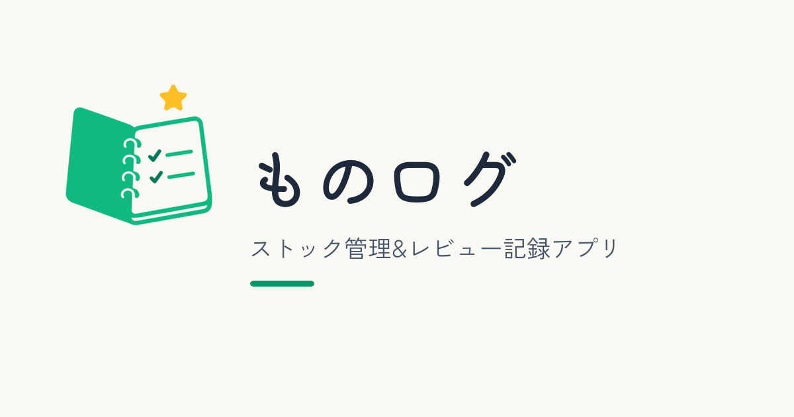
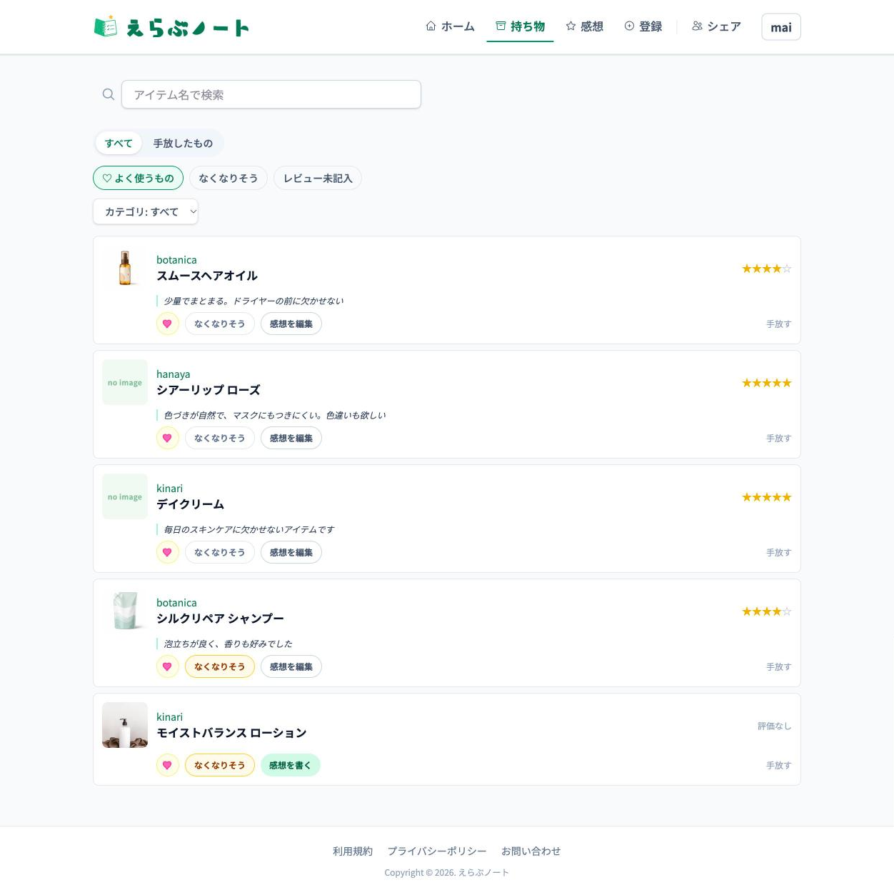
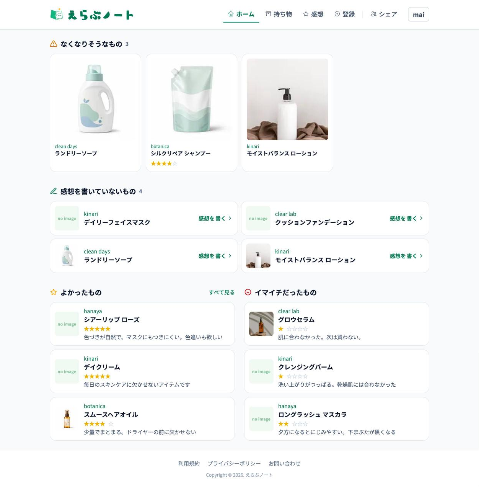
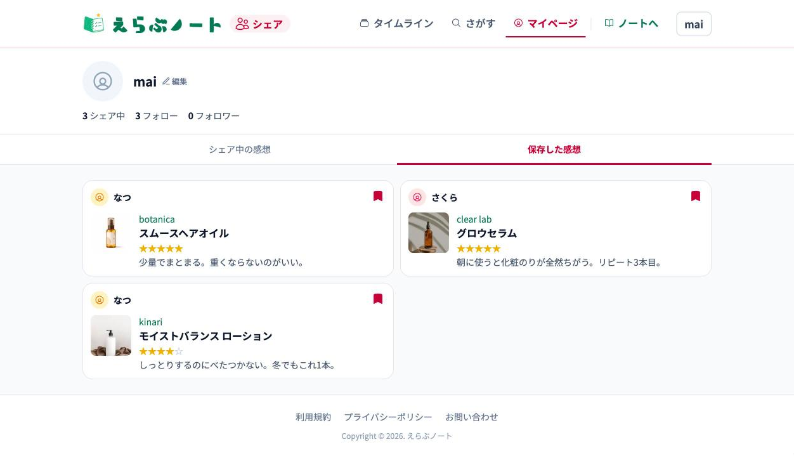
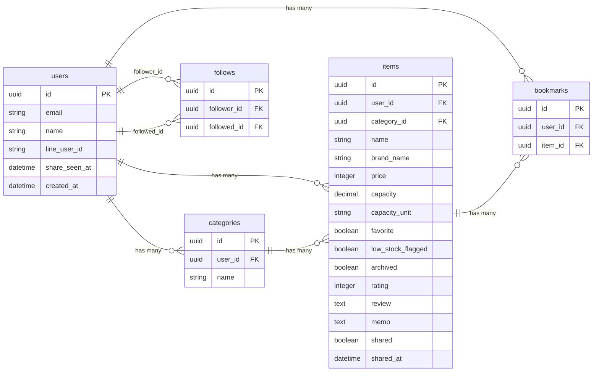

# えらぶノート

## サービス概要

えらぶノートは、化粧品や日用品を選ぶときの判断をサポートする、個人向けのアイテム管理アプリです。

アイテム名・ブランド名・カテゴリ・価格・容量・画像・メモを登録し、使った感想を評価とレビューとして残せます。過去の自分の感想をストックしていくことで、「自分は何が好きか」がわかっていき、次の買い物を楽しく選べるようになります。

感想は、シェアすることもできます。ほかの人の感想を読んだり、気になった感想を保存したりして、選ぶときの参考にできます。

## アプリURL

https://monolog-note.com/

トップの「ゲストログイン」から、登録なしでサンプルデータ入りの状態を試せます。メールアドレスのほか、LINEでもログイン・登録できます。

## このサービスへの思い・作りたい理由

化粧品や日用品などをいろいろ試すのが好きで、1つのアイテム（シャンプー、アイシャドウ、リップなど）でも複数種類を持っています。

そうした中で、それぞれのアイテムにお気に入りポイントがあって選んでいるはずなのに、どこが良かったか忘れていたり、何を使ったことがあるかさえ忘れてしまったりすることがありました。

もっと自分のお気に入りのアイテムを大切にしたい、好きなものが見つかれば日々がもっと楽しくなる――そんな思いでこのアプリを作りました。

自分で決めることは幸福度を上げる一方で、選択肢が多すぎるとストレスにもなります。えらぶノートは、感想を記録したりシェアすることで、「自分で選ぶ」体験をサポートすることを目指しています。

## ユーザー層について

### メインターゲット

日用品や化粧品などを、自分なりに選んで使いたい人

### サブターゲット

家庭内の日用品を管理している人

## 差別化ポイント

LIPS や @cosme などの口コミサイトは、他の人のレビューを探すことが中心で、自分が持っているものや使い終わったものの記録には特化していません。zaico などの在庫管理アプリは、持っているものの管理はできますが、感想をわかりやすく記録することはできません。えらぶノートでは、アイテムと紐づけて自分の感想を一緒に記録していくことができます。

感想はシェアすることもでき、他の人の感想も見られます。
フォロー機能で、好みが近いと感じた人の感想も参考にすることができます。

## 主な機能

### 記録する

  

使っているアイテムを登録して、使った感想を星評価とレビューで残せます。持ち物一覧では、アイテムと感想を一緒に見られます。

### 見返す

  

ホームには、「なくなりそう」の印をつけたものや、よかった/イマイチだったものが並びます。在庫の数までは管理せず、なくなりそうなときに、前の感想を見て「またリピートするか、別のものを試すか」を決められるようにしています。

### シェアする

  

感想をシェアして、フォローした人の感想を参考にできます。気になった感想は保存して、マイページで見返せます。

## 画面と機能

### マイノート

| 画面 | できること |
| --- | --- |
| ホーム | なくなりそうなもの・感想を書いていないもの・よかった/イマイチだったものを見る |
| 持ち物一覧 | 名前・カテゴリ・状態（よく使うもの/なくなりそう/手放したもの など）で絞り込む |
| アイテム登録・詳細 | アイテムを登録する、容量あたりのコストを見る、手放す |
| 感想を書く | 星評価とレビューを書く、シェアする |
| 感想を振り返る | 評価・名前・カテゴリで、過去の感想をさがす |

### シェア

| 画面 | できること |
| --- | --- |
| タイムライン | フォローしている人の感想を、新しい順に見る |
| さがす | シェアされた感想を、商品名でさがす |
| プロフィール | ほかの人のシェア中の感想を見る、フォローする |
| マイページ | 自分のシェア中の感想と、保存した感想を見る |

## 技術スタック

- Ruby / Rails 8
- PostgreSQL（Neon）
- Render（本番）
- Docker（開発）
- Tailwind CSS
- Hotwire（Turbo / Stimulus）
- Devise / omniauth-oauth2
- Active Storage（Cloudflare R2 / image_processing / libvips）
- Resend（本番のメール送信）
- Minitest / GitHub Actions

## 使用技術の選定理由

| 技術 | 理由 |
| --- | --- |
| Ruby on Rails | 認証・CRUD・画像アップロードなど、必要な機能を少ないコードで作れるため。 |
| PostgreSQL（Neon） | はじめは Render の無料 DB を使っていましたが、90日で期限が切れるため、期限のない Neon に移行。 |
| Render | GitHub と連携してデプロイでき、無料枠を続けて使えるため。 |
| Docker | 自分の PC の環境に左右されず、バージョンを固定して開発できるため。 |
| Tailwind CSS | スマホで使う前提のアプリなので、モバイルファーストで画面を作りやすいため。 |
| Devise | 認証を自作すると、パスワードやセッションの安全面のリスクが大きいため。 |
| omniauth-oauth2（LINE認証） | 既存の `omniauth-line` は長くメンテナンスされていないため、`omniauth-oauth2` を土台に独自のストラテジを作成。 |
| Cloudflare R2 | 画像の保存先。無料枠が大きく、個人開発のコストを抑えられるため。 |
| Minitest / GitHub Actions | Rails 標準で、設定が少なく済むため。プルリクエストごとにテストと Lint を自動で回してからマージ。 |

## ER図

現在の実装のテーブル構成です。

## 技術的に工夫した点

### アイテムが状態を直接持つ設計

当初は使用開始・終了を履歴として記録する設計でしたが、運用してみて「使用中フラグの管理が煩雑」と気づき、アプリのテーマ（選ぶための情報を溜めておくこと）に立ち返ってシンプルな設計に作り直しました。状態や評価・レビューは履歴テーブルを介さず `items` が直接持ち、「手放した」は削除ではなくアーカイブとして感想を残します。

### ゲストと実ユーザーへのデータの出し分け

ゲストは誰でも使えるため、ゲストの感想は実ユーザーに見せず、ゲストにはサンプルユーザーの感想だけを見せています。この条件は `User.visible_to`・`Item.shared_for` の1か所にまとめ、シェアのすべての画面で使っています。

### ニックネームを公開する前の確認

LINE で登録すると、LINE の表示名がそのままニックネームになるため、はじめてシェア・フォローするときだけ確認画面を出しています。確認済みかどうかはカラムを足さず、シェア・フォローをしたことがあるかで判定しています。

### 画像サイズの出し分けと N+1 対策

画像は variant で一覧用と詳細用のサイズを分け、一覧では `with_attached_image`・`includes` でまとめて読み込んで、N+1 を防いでいます。

## 今後の実装予定

- アイテム登録を簡単にするためのバーコードスキャン
- 「なくなりそう」になったアイテムを、前回の感想と一緒に LINE で知らせる通知

機能を追加・削除するときの判断基準は [設計の原則と判断の記録](docs/design-principles.md) にまとめています。
