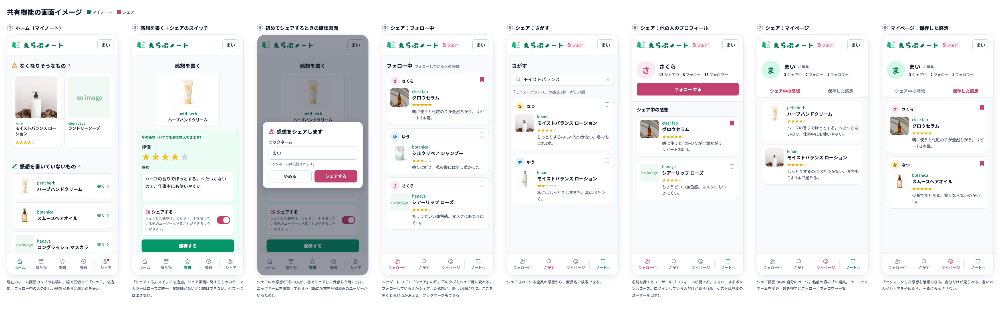
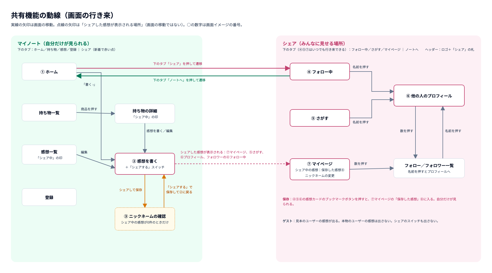
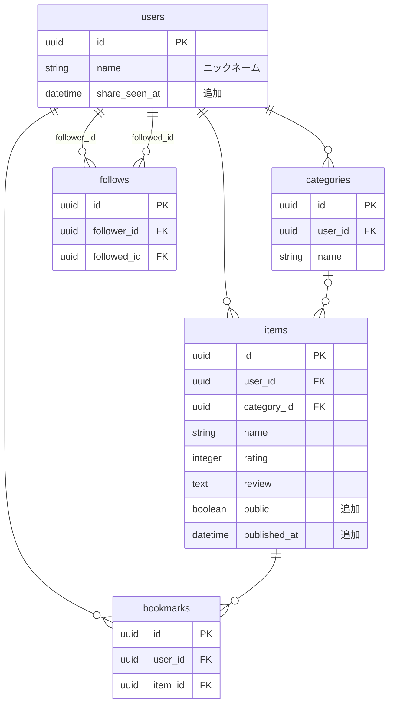

# 共有機能 実装計画（シェア：公開・フォロー・さがす・保存）

> **ステータス: 計画**（2026-11-03）
> ステップ1から順に実装し、ステップごとに本番へ出す。

## 目的

感想を公開し、好みが近い人の感想も「えらぶ」ときの材料にできるようにする。
フォローすることで、「この人が気に入っているもの」を参考に選べるようにする。

アプリを **「マイノート」**（自分だけの記録。今のアプリ）と **「シェア」**（公開の場所）の2つに分ける。
参考にしたアプリは、ブクログ（自分の本棚と、みんなの感想）と Strava（自分の記録と、フォローした人のフィード）。

アイテムは共有しない。共有するのは感想だけで、アイテムの名前・ブランド・画像は一緒に出す。

## 画面イメージ

| 番号 | 画面 | 中身 |
|---|---|---|
| ① | ホーム | 下のタブの右端に「シェア」。フォロー中の人の新しい感想があると赤い点 |
| ② | 感想を書く | 「シェアする」スイッチを追加 |
| ③ | ニックネームの確認 | シェア中の感想が1つもない人がシェアすると出る |
| ④ | フォロー中 | フォローしている人の感想を、新しい順に |
| ⑤ | さがす | 商品名で探す（部分一致）。空のときは新しい順に全部 |
| ⑥ | 他の人のプロフィール | シェア中の感想と、フォローするボタン |
| ⑦ | マイページ | 他の人から見た自分のページ。ニックネームの変更 |
| ⑧ | 保存した感想 | マイページのタブ |

シェアの画面は、ロゴの横に「シェア」の札を出し、テーマカラーをローズにする。下のタブは フォロー中／さがす／マイページ ｜ ノートへ。

## 動線

## 決定事項

| 論点 | 決定内容 |
|---|---|
| 公開 | 感想ごとにスイッチ。**初期値は非公開**。星評価がないと公開できない |
| 画面の言葉 | 「シェアする」「シェア中」を使い、「公開」は使わない（「シェアに公開」だと意味が重なるため） |
| ニックネーム | 今の `name` を使う（本名で登録している人もいるため、初めて公開するときに確認） |
| 見られる人 | **ログインしている人だけ** |
| ゲスト | **見本のユーザーの感想だけ**を見せる（ゲストは誰でも入れるため）。公開はできない |
| 公開する情報 | 商品名・ブランド名・画像・星評価・感想・手放したかどうか |
| フォロー | 相手の許可は不要 |
| 並び順 | 公開した日時、または公開中に感想を更新した日時の新しい順 |
| 赤い点 | シェアを最後に開いた時刻より後に、フォロー中の人の感想が出ていれば付ける |
| 保存 | 自分だけが見られる。書いた人が非公開にしたら一覧に出さない |

## 実装の順番

| ステップ | 中身 | issue |
|---|---|---|
| 1 | 利用規約の更新、公開スイッチ、ニックネームの確認、シェアの部屋（ヘッダー・下のタブ）、プロフィール／マイページ | #375、#376 |
| 2 | フォロー、フォロー／フォロワー一覧、フォロー中、赤い点 | #377 |
| 3 | さがす、ゲスト用の見本ユーザー | #378 |
| 4 | 保存（ブックマーク） | #400 |

利用規約（#375）は、公開できるようになる前に必要なので、ステップ1の最初にやる。

## データベースの変更

カラム・テーブルを足すだけ。公開スイッチの初期値は非公開なので、既存ユーザーのデータは勝手に公開されない。

| テーブル | 追加するもの | ステップ |
|---|---|---|
| items | `public`（boolean、default: false）、`published_at`（datetime） | 1 |
| follows（新規） | `follower_id`、`followed_id`（どちらも users） | 2 |
| users | `share_seen_at`（datetime。赤い点用） | 2 |
| bookmarks（新規） | `user_id`、`item_id` | 4 |

- 見本のユーザーは、ゲストと同じくメールアドレスのドメインで見分ける（カラムは足さない）
- ユーザーやアイテムを消したら、`follows`・`bookmarks` も一緒に消す

`follows`（users と users をつなぐ）と `bookmarks`（users と items をつなぐ）は、新しく追加する中間テーブル。items の価格・容量・メモなど、今回変えないカラムは省略。

## 実装で気をつけること

- 公開のルール（星評価がないものは公開できない、星評価を消したら非公開に戻す、`published_at` の更新）は model にまとめる
- シェアに出す感想の条件は model の1か所にまとめ、3つの画面で使い回す（ゲストには見本だけを表示、本物のユーザーには本物の感想だけを表示）
- 公開する項目は1つの partial にまとめ、メモなど不要な情報を出さない
